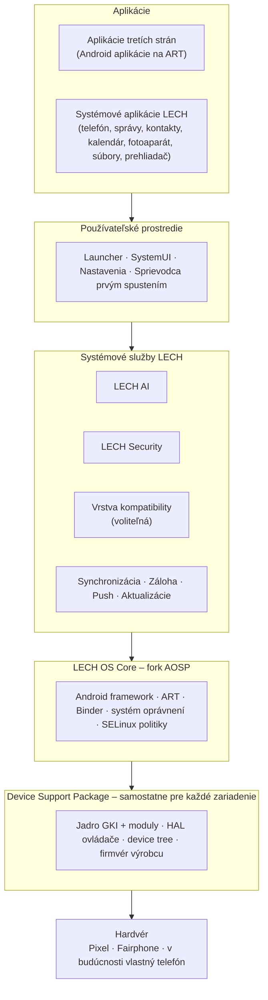
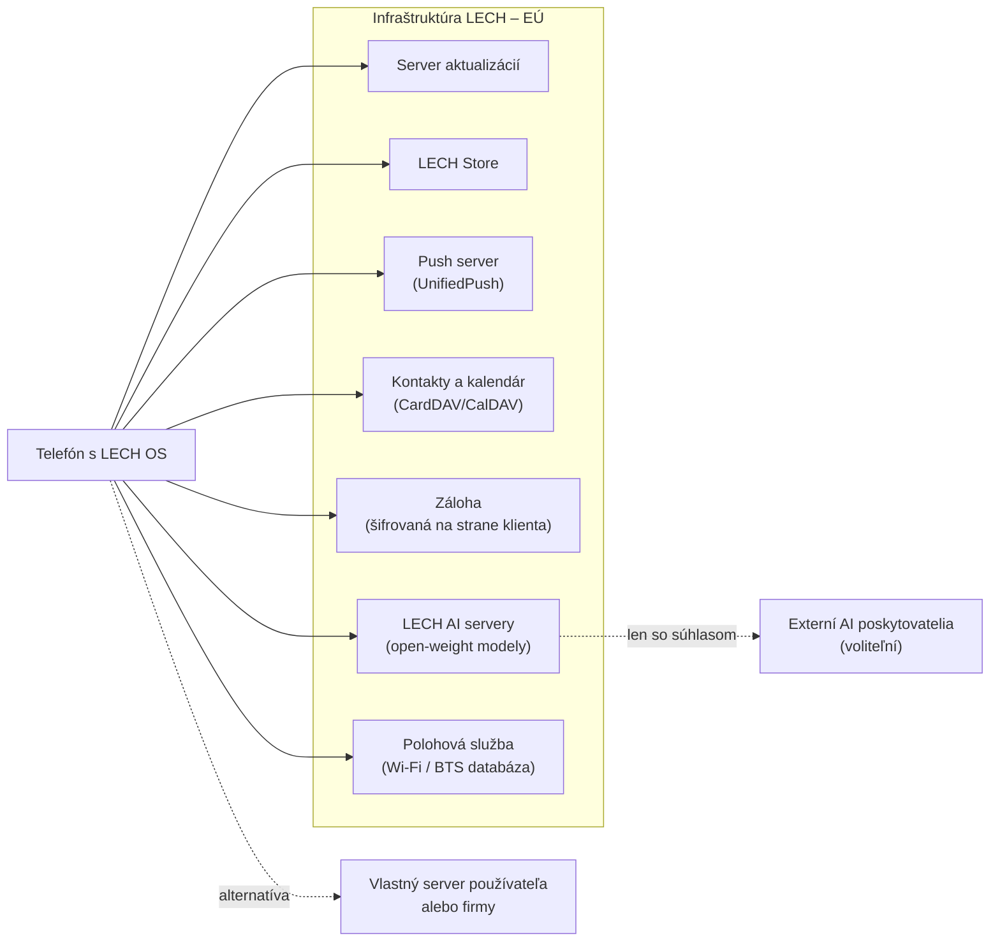
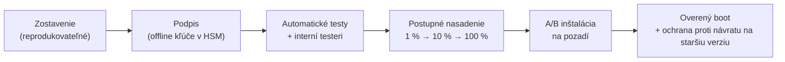

# 02 – Architektúra systému

## Prehľad vrstiev

| Vrstva | Čo obsahuje | Kto ju udržiava |
|--------|-------------|-----------------|
| Aplikácie | Bežné Android aplikácie a systémové aplikácie LECH | Vývojári aplikácií / tím LECH |
| Používateľské prostredie | Vzhľad, launcher, nastavenia, sprievodca s voľbami súkromia | Tím LECH |
| Systémové služby LECH | AI, bezpečnosť, kompatibilita, synchronizácia, aktualizácie | Tím LECH |
| LECH OS Core | AOSP framework s našimi úpravami (oprávnenia, súkromie, odstránenie volaní na Google servery) | Tím LECH, upstream AOSP |
| Device Support Package | Všetko, čo je špecifické pre konkrétny telefón | Tím LECH + výrobca (firmvér) |
| Hardvér | Telefón, modem, bezpečnostný čip | Výrobca |

## Device Support Package – kľúč k cestám A aj B

Najdôležitejšie architektonické rozhodnutie je **prísne oddeliť všetko, čo závisí od konkrétneho telefónu**,
od zvyšku systému. Toto oddelenie umožňuje obidve obchodné cesty z [ADR-0001](adr/0001-obchodna-cesta.md):

- **Cesta A** (OS pre telefóny rôznych výrobcov): nové zariadenie = nový Device Support Package (DSP).
  Zvyšok systému ostáva rovnaký.
- **Cesta B** (vlastný telefón): vlastný telefón = ďalší DSP, tentoraz vyrobený spolu s ODM výrobcom.
  Pre systém nad ním je to len ďalšie zariadenie.

Android to technicky podporuje cez **Project Treble** (stabilné rozhranie medzi systémom a ovládačmi výrobcu)
a **GKI – Generic Kernel Image** (spoločné jadro + moduly výrobcu). Pravidlá pre náš kód:

1. Žiadny kód mimo DSP nesmie testovať konkrétny model telefónu (`if (device == "pixel")` je zakázané).
2. Rozdiely medzi zariadeniami sa riešia cez *vlastnosti zariadenia* (má NPU? má eSIM? má secure element?),
   ktoré DSP deklaruje.
3. Každý DSP musí prejsť rovnakou testovacou sadou (bootovanie, overený boot, OTA, oprávnenia, kompatibilita).

### Čo musí každé podporované zariadenie spĺňať

| Požiadavka | Prečo |
|------------|-------|
| Odomknuteľný **a znovu zamknuteľný** bootloader s vlastnými kľúčmi (Android Verified Boot) | Bez zamknutého bootloadera nemá zariadenie overený boot – útočník s fyzickým prístupom môže podvrhnúť systém. |
| Hardvérové úložisko kľúčov (TEE, ideálne samostatný bezpečnostný čip) | Ochrana šifrovacích kľúčov a hardvérová atestácia. |
| Aktualizácie firmvéru od výrobcu (modem, bootloader, TEE) | Tieto časti nevieme opravovať sami. Koniec podpory výrobcu = koniec bezpečnej podpory u nás. |
| Dostupné zdrojové kódy jadra | Povinnosť z licencie GPL a podmienka na vlastné úpravy jadra. |
| Dostupnosť v EÚ a odomknuteľná verzia bez operátorského zámku | Praktická dostupnosť pre zákazníkov. |

## Systémové služby LECH

| Služba | Úloha | Prístup na internet | Poznámka |
|--------|-------|---------------------|----------|
| `lech.ai.orchestrator` | Porozumenie príkazom, plánovanie akcií | **Nie** | Volá model a register akcií cez Binder |
| `lech.ai.runtime` | Beh lokálnych AI modelov | **Nie** | Izolovaný proces, len výpočet |
| `lech.ai.policy` | Rozhoduje, či akcia smie prebehnúť a či treba súhlas | **Nie** | Deterministický kód, nie AI |
| `lech.ai.gateway` | Volanie cloudových AI poskytovateľov | Áno – len po súhlase | Jediný AI proces so sieťou; všetko zapisuje do panelu „Odchod údajov“ |
| `lech.guard` | Bezpečnostné politiky, kontrola aplikácií, LECH Privacy Control | Nie | Pozri [docs/05](05-lech-security.md) a [docs/12](12-lech-privacy-control.md) |
| `lech.compat` | Voliteľná vrstva kompatibility s Google službami | Podľa voľby používateľa | Pozri [docs/03](03-nezavislost-od-google.md) |
| `lech.sync` | Kontakty a kalendár (CardDAV/CalDAV) | Áno | Voliteľný server: LECH Cloud alebo vlastný |
| `lech.backup` | Šifrovaná záloha | Áno | Kľúč má len používateľ |
| `lech.push` | Doručovanie notifikácií (UnifiedPush) | Áno | Jedno spojenie pre všetky aplikácie – šetrí batériu |
| `lech.update` | Systémové aktualizácie | Áno | Kontrola bez identifikátora zariadenia |

Rozdelenie AI do viacerých procesov je zámerné: proces, ktorý vidí súkromné údaje a beží v ňom model,
**fyzicky nemá prístup na internet**. Údaje môžu odísť len cez `lech.ai.gateway`, a to len so súhlasom.

## Backendová infraštruktúra (LECH Cloud)

Pravidlá pre každú backendovú službu:

1. **Voliteľná** – telefón musí fungovať aj bez nej.
2. **Otvorený protokol** – CardDAV, CalDAV, WebDAV, UnifiedPush a pod. Používateľ alebo firma môže použiť
   vlastný server.
3. **Šifrovanie na strane klienta**, kde je to možné (záloha, súbory) – server nemá kľúč.
4. **Prevádzka v EÚ** a minimálne logovanie.

## Aktualizácie

- **A/B (seamless) aktualizácie**: nová verzia sa inštaluje do druhého oddielu na pozadí. Ak nenabootuje,
  telefón sa automaticky vráti na predchádzajúcu verziu.
- **Rollback protection**: útočník nemôže nainštalovať staršiu verziu so známou zraniteľnosťou.
- **Tempo:** mesačné bezpečnostné aktualizácie; funkčné verzie podľa vydaní AOSP. Od roku 2026 Google zverejňuje
  zdrojové kódy AOSP len dvakrát ročne (Q2 a Q4) a odporúča stavať z vetvy `android-latest-release`.
  Bezpečnostné záplaty majú vlastný mesačný cyklus.

## Plánovaná štruktúra repozitárov

Tento repozitár (`Lech-OS`) ostáva **centrálnym miestom pre architektúru, rozhodnutia a špecifikácie**.
Od etapy 2 pribudnú ďalšie repozitáre:

| Repozitár | Obsah |
|-----------|-------|
| `lech-manifest` | Manifest pre nástroj `repo` – ktoré vetvy AOSP a ktoré naše forky tvoria systém |
| `lech-platform-*` | Forky repozitárov AOSP, ktoré upravujeme (napr. `frameworks/base`, `packages/apps/Settings`) |
| `lech-device-<výrobca>-<model>` | Device Support Package pre konkrétne zariadenie |
| `lech-ai` | Systémová služba LECH AI, register akcií, politika súhlasov |
| `lech-apps-*` | Systémové aplikácie LECH |
| `lech-store` | Klient a backend obchodu |
| `lech-cloud` | Backendové služby a infraštruktúra ako kód |
| `lech-ci` | Zostavovacie a testovacie pipeline, audit sieťovej prevádzky, kompatibilitné testy |

Licencie repozitárov určuje [ADR-0006](adr/0006-licencia-otvoreny-kod.md): všetko, čo beží v telefóne, je pod Apache 2.0
(jadro pod GPL v2), serverové časti `lech-cloud` a backend `lech-store` pod AGPL v3.

Podpisové kľúče **nikdy nie sú v žiadnom repozitári** – pozri [docs/05](05-lech-security.md#správa-kľúčov).

## Zostavovacia infraštruktúra

Zostavenie AOSP je náročné na hardvér. Podľa oficiálnych požiadaviek Google je potrebných aspoň 64 GB RAM
a približne 400 GB voľného miesta na disku na jedno pracovné prostredie. Odporúčanie:

- 1–2 výkonné zostavovacie servery (napr. 32+ jadier, 128 GB RAM, rýchle NVMe disky) alebo prenájom v európskom cloude,
- cache zostavenia zdieľaná medzi vývojármi,
- virtuálne zariadenie **Cuttlefish** v CI na automatické testy bez fyzických telefónov.

## Zdroje

- Zmena harmonogramu AOSP na Q2 a Q4: [Android Authority](https://www.androidauthority.com/aosp-source-code-schedule-3630018/),
  [PiunikaWeb, 7. 1. 2026](https://piunikaweb.com/2026/01/07/android-aosp-source-code-q2-and-q4-pixel-monthly-security-patches-unchanged/) (overené 31. 10. 2026)
