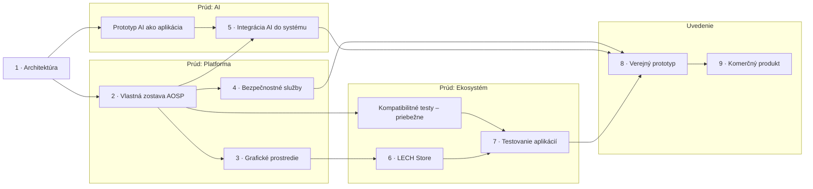

# 08 – Plán etáp

## Úpravy pôvodného plánu

Pôvodných 9 etáp ostáva, s tromi úpravami, ktoré znižujú riziko:

1. **Bezpečnosť nie je etapa, ale vlastnosť od začiatku.** Overený boot, vlastné kľúče a podpísané aktualizácie
   musia byť hotové už v etape 2. Etapa 4 pridáva nadstavbové bezpečnostné služby.
2. **Testovanie kompatibility aplikácií beží priebežne od etapy 2**, nie až v etape 7. Etapa 7 je jeho vyvrcholenie
   (top 200 aplikácií, banky, verejná databáza).
3. **Prototyp LECH AI začne skôr** – ako bežná aplikácia, ktorá sa dá rýchlo testovať aj na obyčajnom telefóne.
   V etape 5 sa presunie do systému.

## Paralelné pracovné prúdy

Šípky znázorňujú závislosti: etapy v rôznych prúdoch bežia súbežne, napr. etapy 3 a 4 začínajú hneď po etape 2
a prototyp AI vzniká už počas etapy 2.

## Etapy

### Etapa 1 – Architektúra a návrh systému

**Stav: kľúčové rozhodnutia prijaté 1. 11. 2026** (ADR 0001–0007). Zostáva: zoznam cieľových aplikácií, ochranná známka, odhad tímu a rozpočtu.

| | |
|---|---|
| **Cieľ** | Zhoda na architektúre, rozhodnutiach a pláne |
| **Výstupy** | Tento repozitár: vízia, architektúra, ADR 0001–0007, katalóg AI akcií, model hrozieb; zoznam 200 cieľových aplikácií; overenie názvu a ochrannej známky; odhad tímu a rozpočtu |
| **Hotové, keď** | ADR 0001–0007 sú prijaté ✅; zoznam cieľových aplikácií a overenie ochrannej známky sú hotové |

### Etapa 2 – Vlastná zostava AOSP

Postup a zoznam úloh: [docs/11 – štart na Cuttlefish](11-etapa-2-cuttlefish.md).

| | |
|---|---|
| **Cieľ** | LECH OS beží na Cuttlefish a na Pixel so zamknutým bootloaderom |
| **Výstupy** | Zostavovacia infraštruktúra a CI; manifest a forky; Device Support Package pre Pixel; vlastné podpisové kľúče; server aktualizácií v0; odstránenie spojení na Google; automatický audit sieťovej prevádzky; prvé kompatibilitné testy |
| **Hotové, keď** | Pixel nabootuje LECH OS so zamknutým bootloaderom, nainštaluje aktualizáciu z nášho servera a pri prvom spustení nevytvorí žiadne neznáme sieťové spojenie |

### Etapa 3 – Vlastné grafické prostredie

| | |
|---|---|
| **Cieľ** | Rozpoznateľný a pohodlný LECH OS |
| **Výstupy** | Vizuálna identita; launcher; úpravy SystemUI a nastavení; sprievodca prvým spustením s voľbami súkromia (bez konta, voľba vrstvy kompatibility); prístupnosť; lokalizácia SK, CZ, EN |
| **Hotové, keď** | Testovací používatelia bez technických znalostí prejdú nastavením telefónu bez pomoci |

### Etapa 4 – Vlastné bezpečnostné služby

| | |
|---|---|
| **Cieľ** | Funkcie súkromia, ktoré bežný Android nemá |
| **Výstupy** | Povolenia Sieť a Senzory; rozsahy kontaktov a úložiska; panel „Odchod údajov“; lokálny skener aplikácií; spevnenie systému; **základ správy firemných zariadenií** (device owner, pracovný profil, zriadenie cez QR kód – [ADR-0007](adr/0007-prvy-trh-firmy.md)); interná bezpečnostná revízia |
| **Hotové, keď** | Všetky funkcie z [docs/05](05-lech-security.md) majú automatické testy a prešli internou revíziou |

### Etapa 5 – Integrácia AI

| | |
|---|---|
| **Cieľ** | LECH AI ako systémová služba |
| **Výstupy** | Orchestrátor, register akcií, modul pravidiel, lokálny model, hlasové ovládanie v slovenčine, AI brána s panelom odchodu údajov, testovacia sada (vrátane prompt injection) |
| **Hotové, keď** | Všetkých 7 príkladových príkazov z [docs/04](04-lech-ai.md#príklady-príkazov) funguje v režime lietadlo (okrem tých, ktoré vyžadujú sieť zo svojej podstaty) a žiadna akcia R3 neprebehne bez potvrdenia |

### Etapa 6 – Obchod s aplikáciami

| | |
|---|---|
| **Cieľ** | Používateľ si vie nainštalovať aplikácie bez Google |
| **Výstupy** | Klient LECH Store; kurátorský katalóg; automatická kontrola aplikácií; štítky súkromia; beta portál pre vývojárov; **správcovský server pre firmy** (zoznam schválených aplikácií, politiky zariadení) |
| **Hotové, keď** | Katalóg pokrýva bežné potreby (komunikácia, mapy, prehliadač, kancelária, médiá) a aktualizácie fungujú automaticky |

### Etapa 7 – Testovanie Android aplikácií

| | |
|---|---|
| **Cieľ** | Zmeraná a zverejnená kompatibilita |
| **Výstupy** | Výsledky top 200 aplikácií v troch režimoch; vrstva kompatibility „Google Play v sandboxe“; stav bankových aplikácií SK/CZ a rokovaní s bankami; verejná databáza kompatibility; druhá platforma (Fairphone) |
| **Hotové, keď** | Splnené cieľové metriky z [docs/03](03-nezavislost-od-google.md#meranie-kompatibility) |

### Etapa 8 – Prvý verejný prototyp

| | |
|---|---|
| **Cieľ** | Spätná väzba od reálnych používateľov |
| **Výstupy** | **Pilot pre 1–3 organizácie (20–100 zariadení)**; komunitný beta program (napr. 100–500 testerov); webový inštalátor; dokumentácia; **nezávislý bezpečnostný audit**; bug bounty; pravidlá zverejňovania zraniteľností |
| **Hotové, keď** | Audit neodhalil neopravené kritické zraniteľnosti; pilotné organizácie a testeri potvrdili stabilitu a použiteľnosť v dohodnutých hodnotách |

### Etapa 9 – Príprava komerčného produktu

| | |
|---|---|
| **Cieľ** | Produkt, ktorý sa dá predávať a podporovať |
| **Výstupy** | Súlad s CRA a ďalšou reguláciou ([docs/09](09-pravo-a-licencie.md)); zmluvy a SLA pre firemných zákazníkov; zákaznícka podpora; cenník a predplatné LECH Cloud; distribúcia (inštalátor, predinštalované telefóny – cesta A+); partnerstvá; druhý nezávislý audit |
| **Hotové, keď** | Prvý platiaci zákazník dostane telefón alebo inštaláciu so zmluvne garantovanou dobou podpory |

## Tím (orientačne)

Minimálne zloženie pre etapy 2–8:

| Rola | Počet | Poznámka |
|------|-------|----------|
| Platformový inžinier AOSP | 2 | Framework, oprávnenia, zostavy |
| Inžinier jadra a zariadení | 1 | Device Support Package, firmvér, bootloader |
| Android vývojár (UI, aplikácie) | 1–2 | Launcher, nastavenia, systémové aplikácie, Store klient |
| ML inžinier (on-device AI) | 1–2 | Modely, výkon, slovenčina |
| Backend / DevOps | 1 | CI, server aktualizácií, LECH Cloud |
| Bezpečnostný inžinier | 1 | Model hrozieb, revízie, spevnenie |
| Produkt / UX | 1 | Môže byť čiastočný úväzok |
| Právne poradenstvo | externe | Licencie, ochranné známky, GDPR, CRA |

Spolu približne **8–10 ľudí**. S menším tímom je plán realizovateľný, ale pomalší – prioritou potom ostávajú
etapy 2, 4 a 5 (základ, bezpečnosť, AI), ktoré tvoria jadro odlíšenia.

> Odhad trvania a rozpočtu vypracujeme v rámci etapy 1 po rozhodnutí o veľkosti tímu a cieľovom trhu.
