# 08 – Plán etáp

## Princíp: jedna vec naraz

Vývoj ide **postupne**, vždy jedna hlavná vec naraz, a medzi etapami sú **brány kvality** – ďalšia etapa začne,
až keď predchádzajúca splní merateľné kritériá ([ADR-0008](adr/0008-postupny-vyvoj-a-brany.md)).
Cieľom je, aby sme o rok nemuseli prerábať polovicu systému.

Bezpečnosť a aktualizácie nie sú až na konci: overený boot, vlastné kľúče, podpísané aktualizácie a meranie sieťovej
prevádzky sú súčasťou etapy 2 a brány „Overený základ“. Etapa 4 pridáva nadstavbu (LECH Privacy Control).

```mermaid
flowchart LR
    E2["2 · LECH OS na Cuttlefish,<br/>potom na Pixeli"] --> B1{{"Brána 1<br/>Overený základ"}}
    B1 --> E3["3 · Grafické<br/>prostredie"] --> B2{{"Brána 2<br/>Použiteľný systém"}}
    B2 --> E4["4 · Bezpečnosť a<br/>Privacy Control"] --> B3{{"Brána 3<br/>Overená bezpečnosť"}}
    B3 --> E5["5 · Lokálna AI"] --> B4{{"Brána 4<br/>Overená AI"}}
    B4 --> E6["6 · LECH Store"] --> E7["7 · Testovanie<br/>aplikácií"] --> B5{{"Brána 5<br/>Pripravené na pilot"}}
    B5 --> E8["8 · Pilot a verejný<br/>prototyp"] --> E9["9 · Komerčný<br/>produkt"]
```

Kritériá brán sú v [ADR-0008](adr/0008-postupny-vyvoj-a-brany.md#rozhodnutie).

### Čo beží popri vývoji

Len úlohy, ktoré neberú kapacitu vývojárov a trvajú dlho:

| Úloha | Prečo už teraz |
|-------|----------------|
| Kontakty s bankami ([docs/13](13-bankove-aplikacie.md)) | Rokovania trvajú mesiace |
| Hľadanie 1–3 pilotných organizácií | Pilot v etape 8 treba dohodnúť vopred |
| Financovanie | Určuje veľkosť tímu |
| Právne otázky (licencie, ochranná známka pred komerčným uvedením) | Pozri [docs/09](09-pravo-a-licencie.md) |
| **Test realizovateľnosti lokálnej AI v slovenčine** – jediná vývojová výnimka, najviac 2 týždne | AI je najdôležitejšia časť a najväčšia technická neznáma |

## Etapy

### Etapa 1 – Architektúra a návrh systému

**Stav: kľúčové rozhodnutia prijaté 1. 11. 2026** (ADR 0001–0007). Zostáva: zoznam cieľových aplikácií, ochranná známka, odhad tímu a rozpočtu.

| | |
|---|---|
| **Cieľ** | Zhoda na architektúre, rozhodnutiach a pláne |
| **Výstupy** | Tento repozitár: vízia, architektúra, ADR 0001–0007, katalóg AI akcií, model hrozieb; zoznam 200 cieľových aplikácií; overenie názvu a ochrannej známky; odhad tímu a rozpočtu |
| **Hotové, keď** | ADR 0001–0007 sú prijaté ✅; zoznam cieľových aplikácií a overenie ochrannej známky sú hotové |

### Etapa 2 – Vlastná zostava AOSP

Postup a zoznam úloh: [docs/11 – štart na Cuttlefish](11-etapa-2-cuttlefish.md).

| | |
|---|---|
| **Cieľ** | LECH OS beží na Cuttlefish a na Pixel so zamknutým bootloaderom |
| **Výstupy** | Zostavovacia infraštruktúra a CI; manifest a forky; Device Support Package pre Pixel; vlastné podpisové kľúče; server aktualizácií v0; odstránenie spojení na Google; laboratórne meranie sieťovej prevádzky mimo telefónu; generálka mesačnej aktualizácie ([docs/14](14-aktualizacie-a-podpora.md#overenie-v-etape-2)); prvé kompatibilitné testy |
| **Hotové, keď** | Splnená **brána 1 – Overený základ** ([ADR-0008](adr/0008-postupny-vyvoj-a-brany.md#rozhodnutie)) |

### Etapa 3 – Vlastné grafické prostredie

| | |
|---|---|
| **Cieľ** | Rozpoznateľný a pohodlný LECH OS |
| **Výstupy** | Vizuálna identita; launcher; úpravy SystemUI a nastavení; sprievodca prvým spustením s voľbami súkromia (bez konta, voľba vrstvy kompatibility); prístupnosť; lokalizácia EN, SK, CZ (vlna 1 podľa [ADR-0009](adr/0009-trh-eu.md)); moderné základné aplikácie namiesto starých z AOSP (prehliadač s blokovaním sledovačov, fotoaparát, galéria, SMS); **eSIM bez Google** – správca eSIM OpenEUICC overený na Pixeli 9 ([docs/03](03-nezavislost-od-google.md#náhrady-služieb-google)) |
| **Hotové, keď** | Splnená **brána 2 – Použiteľný systém**: testovací používatelia bez technických znalostí nastavia a používajú telefón bez pomoci |

### Etapa 4 – Bezpečnostný systém a LECH Privacy Control

| | |
|---|---|
| **Cieľ** | Funkcie súkromia, ktoré bežný Android nemá |
| **Výstupy** | **LECH Privacy Control** ([docs/12](12-lech-privacy-control.md)): povolenia Sieť a Senzory, evidencia prevádzky po aplikáciách, prehľad mikrofónu, kamery a polohy; rozsahy kontaktov a úložiska; lokálny skener aplikácií; spevnenie systému; **základ správy firemných zariadenií** (device owner, pracovný profil, zriadenie cez QR kód – [ADR-0007](adr/0007-prvy-trh-firmy.md)); interná bezpečnostná revízia |
| **Hotové, keď** | Splnená **brána 3 – Overená bezpečnosť**: funkcie z [docs/05](05-lech-security.md) a [docs/12](12-lech-privacy-control.md) majú automatické testy, panel sa zhoduje s meraním mimo telefónu, interná revízia bez kritických nálezov |

### Etapa 5 – Lokálna AI (LECH AI Assistant)

| | |
|---|---|
| **Cieľ** | LECH AI ako systémová služba |
| **Výstupy** | Orchestrátor, register akcií, modul pravidiel, lokálny model, hlasové ovládanie v slovenčine, AI brána s panelom odchodu údajov, testovacia sada (vrátane prompt injection) |
| **Hotové, keď** | Splnená **brána 4 – Overená AI**: všetkých 7 príkladových príkazov z [docs/04](04-lech-ai.md#príklady-príkazov) funguje v slovenčine v režime lietadlo (okrem tých, ktoré vyžadujú sieť zo svojej podstaty) a žiadna akcia R3 neprebehne bez potvrdenia |

### Etapa 6 – Obchod s aplikáciami

| | |
|---|---|
| **Cieľ** | Používateľ si vie nainštalovať aplikácie bez Google |
| **Výstupy** | Klient LECH Store; kurátorský katalóg; automatická kontrola aplikácií; štítky súkromia; beta portál pre vývojárov; **správcovský server pre firmy** (zoznam schválených aplikácií, politiky zariadení) |
| **Hotové, keď** | Katalóg pokrýva bežné potreby (komunikácia, mapy, prehliadač, kancelária, médiá) a aktualizácie fungujú automaticky |

### Etapa 7 – Testovanie Android aplikácií

| | |
|---|---|
| **Cieľ** | Zmeraná a zverejnená kompatibilita |
| **Výstupy** | Výsledky top 200 aplikácií v troch režimoch; vrstva kompatibility „Google Play v sandboxe“; stav bankových aplikácií v krajinách vlny 1 (SK, CZ) a rokovaní s bankami; verejná databáza kompatibility; druhá platforma (Fairphone) |
| **Hotové, keď** | Splnená **brána 5 – Pripravené na pilot**: cieľové metriky z [docs/03](03-nezavislost-od-google.md#meranie-kompatibility) a stav bánk z [docs/13](13-bankove-aplikacie.md) |

### Etapa 8 – Pilot a prvý verejný prototyp

| | |
|---|---|
| **Cieľ** | Spätná väzba od reálnych používateľov |
| **Výstupy** | **Pilot pre 1–3 organizácie (20–100 zariadení)**; komunitný beta program (napr. 100–500 testerov); webový inštalátor; dokumentácia; **nezávislý bezpečnostný audit**; bug bounty; pravidlá zverejňovania zraniteľností |
| **Hotové, keď** | Audit neodhalil neopravené kritické zraniteľnosti; pilotné organizácie a testeri potvrdili stabilitu a použiteľnosť v dohodnutých hodnotách |

### Etapa 9 – Príprava komerčného produktu

| | |
|---|---|
| **Cieľ** | Produkt, ktorý sa dá predávať a podporovať |
| **Výstupy** | Súlad s CRA a ďalšou reguláciou ([docs/09](09-pravo-a-licencie.md)); zmluvy a SLA pre firemných zákazníkov; zákaznícka podpora; cenník a predplatné LECH Cloud; distribúcia (inštalátor, predinštalované telefóny – cesta A+); partnerstvá; druhý nezávislý audit |
| **Hotové, keď** | Prvý platiaci zákazník dostane telefón alebo inštaláciu so zmluvne garantovanou dobou podpory |

## Tím (orientačne)

Minimálne zloženie pre etapy 2–8:

| Rola | Počet | Poznámka |
|------|-------|----------|
| Platformový inžinier AOSP | 2 | Framework, oprávnenia, zostavy |
| Inžinier jadra a zariadení | 1 | Device Support Package, firmvér, bootloader |
| Android vývojár (UI, aplikácie) | 1–2 | Launcher, nastavenia, systémové aplikácie, Store klient |
| ML inžinier (on-device AI) | 1–2 | Modely, výkon, slovenčina |
| Backend / DevOps | 1 | CI, server aktualizácií, LECH Cloud |
| Bezpečnostný inžinier | 1 | Model hrozieb, revízie, spevnenie |
| Produkt / UX | 1 | Môže byť čiastočný úväzok |
| Právne poradenstvo | externe | Licencie, ochranné známky, GDPR, CRA |

Spolu približne **8–10 ľudí**. S menším tímom je plán realizovateľný, ale pomalší – prioritou potom ostávajú
etapy 2, 4 a 5 (základ, bezpečnosť, AI), ktoré tvoria jadro odlíšenia.

> Odhad trvania a rozpočtu vypracujeme v rámci etapy 1 po rozhodnutí o veľkosti tímu a cieľovom trhu.
