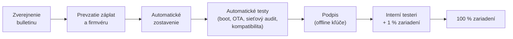

# 14 – Aktualizácie a dlhodobá podpora

## Záväzok

Pravidelné bezpečnostné aktualizácie počas viacerých rokov sú **najväčšia prevádzková povinnosť** výrobcu systému.
Nie je to jednorazový projekt, ale trvalá služba s vlastným tímom a rozpočtom. Preto ju overujeme hneď na začiatku
(brána „Overený základ“, [ADR-0008](adr/0008-postupny-vyvoj-a-brany.md)), nie až pred predajom.

| Záväzok | Hodnota |
|---------|---------|
| Bezpečnostné aktualizácie | **Mesačne** |
| Kritické zraniteľnosti, ktoré sú aktívne zneužívané | Mimoriadna aktualizácia čo najskôr |
| Oneskorenie oproti zverejneniu záplat v AOSP | Cieľ **do 7 dní**, meriame a zverejňujeme |
| Doba podpory zariadenia | Do konca podpory firmvéru od výrobcu zariadenia; **dátum zverejnený pred kúpou** |
| Nové verzie Androidu | Prechod na novú verziu AOSP do niekoľkých mesiacov od jej zverejnenia (Google ich zverejňuje dvakrát ročne) |

### Prečo nesľúbime viac, než dá výrobca

Časti telefónu (modem, bootloader, bezpečnostný čip, ovládače) vie opravovať len výrobca hardvéru. Keď výrobca prestane
vydávať firmvér, telefón už nemôže byť plne bezpečný, nech by sme systém aktualizovali akokoľvek dlho.

| Zariadenie | Podpora od výrobcu |
|------------|--------------------|
| Google Pixel 8 a novšie | 7 rokov od uvedenia na trh (napr. Pixel 9 uvedený v roku 2024 → do roku 2031) |
| Fairphone | Dlhá podpora deklarovaná výrobcom – overiť pre konkrétny model |
| Vlastný telefón (cesta B) | Určíme zmluvou s výrobcom ODM – cieľ aspoň 7 rokov |

## Čo všetko treba mesačne aktualizovať

| Časť | Zdroj zmien | Frekvencia |
|------|-------------|------------|
| Bezpečnostné záplaty AOSP | Bezpečnostný bulletin Android | Mesačne |
| Jadro Linux | Záplaty jadra (GKI) | Mesačne |
| Firmvér zariadenia | Výrobca zariadenia | Podľa výrobcu (Pixel mesačne) |
| **WebView a prehliadač** | Chromium | **Približne každé 4 týždne + mimoriadne opravy** – jedna z najnáročnejších častí |
| Vrstva kompatibility s Google | Nové verzie Google Play Services | Priebežne |
| AI modely a pravidlá | Naše vydania | Podľa potreby |
| Databázy (trackery, škodlivé aplikácie, IP rozsahy) | Naše služby | Týždenne |

## Proces jednej mesačnej aktualizácie

- Každý krok okrem podpisu je automatizovaný. Cieľ: z 7 dní väčšinu času zaberá testovanie, nie ručná práca.
- **A/B aktualizácie:** ak nová verzia nenabootuje, telefón sa automaticky vráti na predchádzajúcu.
- **Ochrana proti návratu na starú verziu:** útočník nemôže nainštalovať staršiu zraniteľnú verziu.
- **Postupné nasadenie:** pri probléme zastavíme nasadenie skôr, ako zasiahne všetkých.

## Tím a náklady

Aj pre 1–2 podporované zariadenia potrebujeme **trvalo aspoň 1–2 ľudí** len na vydávanie aktualizácií
(release engineering) a k tomu kapacitu na WebView. S každým ďalším zariadením rastie počet testov a firmvérov.
Preto podporujeme **malý zoznam zariadení** a každé nové pridávame až po zhodnotení nákladov na jeho podporu.

Rozpočet na aktualizácie počítame od prvého podporovaného zariadenia **na celú dobu podpory**, nie len na vývoj.

## Povinnosti podľa EÚ

- **Akt o kybernetickej odolnosti (CRA):** výrobca určí dobu podpory produktu a počas nej rieši zraniteľnosti.
  Doba podpory má byť spravidla aspoň 5 rokov (overiť presné znenie nariadenia). Aktívne zneužívané zraniteľnosti
  treba hlásiť do 24 hodín (od 11. 9. 2026). Pozri [docs/09](09-pravo-a-licencie.md#akt-o-kybernetickej-odolnosti-cra).
- **Ekodizajn smartfónov** (pre predaj telefónov – cesta A+ a B): minimálna doba poskytovania aktualizácií systému
  po skončení predaja modelu (overiť presné lehoty v nariadení).

## Čo ak by projekt skončil

Používatelia nesmú zostať s telefónom, o ktorom nevedia, či je bezpečný:

- koniec podpory oznámime vopred s presným dátumom,
- posledná aktualizácia umožní bezpečný prechod na iný systém,
- otvorený kód ([ADR-0006](adr/0006-licencia-otvoreny-kod.md)) umožní komunite alebo partnerovi pokračovať
  pod iným názvom.

## Overenie v etape 2

Pred tým, než začneme pridávať funkcie, si celý cyklus vyskúšame naostro (podmienky brány „Overený základ“):

1. Tri po sebe idúce aktualizácie na Pixeli, z toho jedna zámerne chybná – telefón sa musí sám vrátiť na funkčnú verziu.
   Prvý krok na Cuttlefish (E2-08): aktualizácia A/B z vlastného servera v0, podpísaná kľúčom LECH OS
   ([docs/11, časť 4e](11-etapa-2-cuttlefish.md#4e-aktualizácia-z-vlastného-servera-úloha-e2-08)).
2. **Generálka mesačnej aktualizácie:** prevziať jeden skutočný bezpečnostný bulletin a zmerať, koľko dní trvá od
   zverejnenia po nainštalovanú aktualizáciu.
3. Odhad, koľko ľudí a času mesačný cyklus reálne potrebuje.
